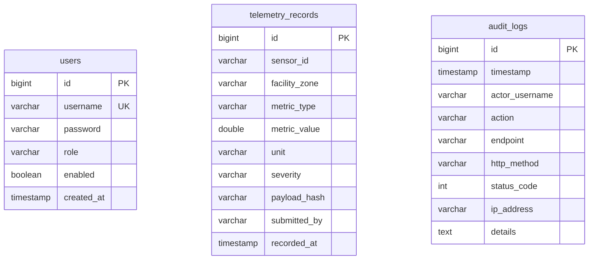
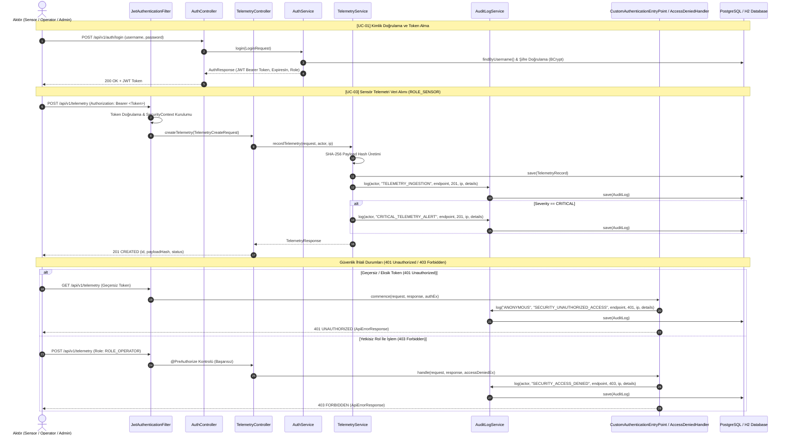
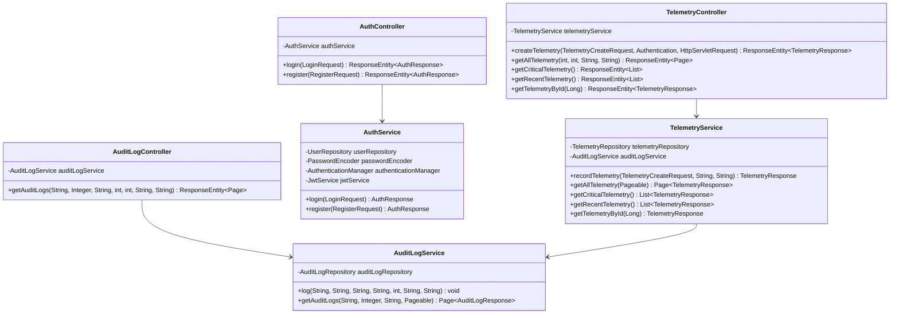
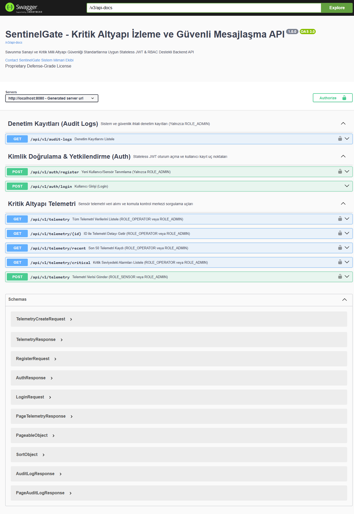
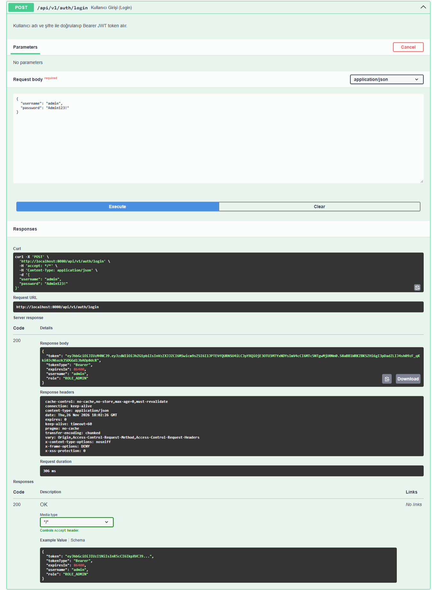
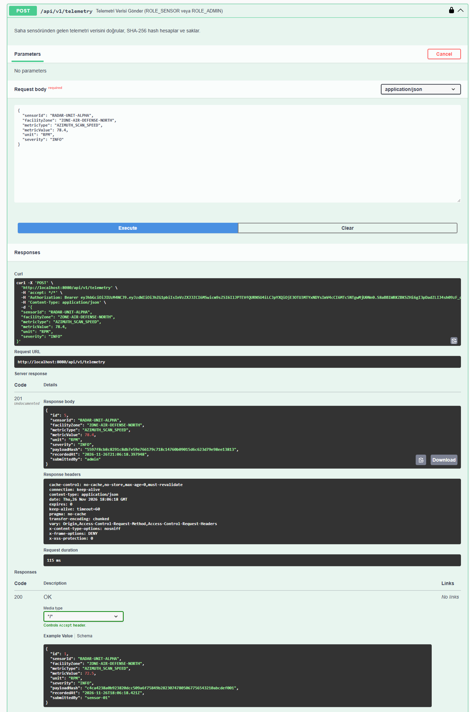
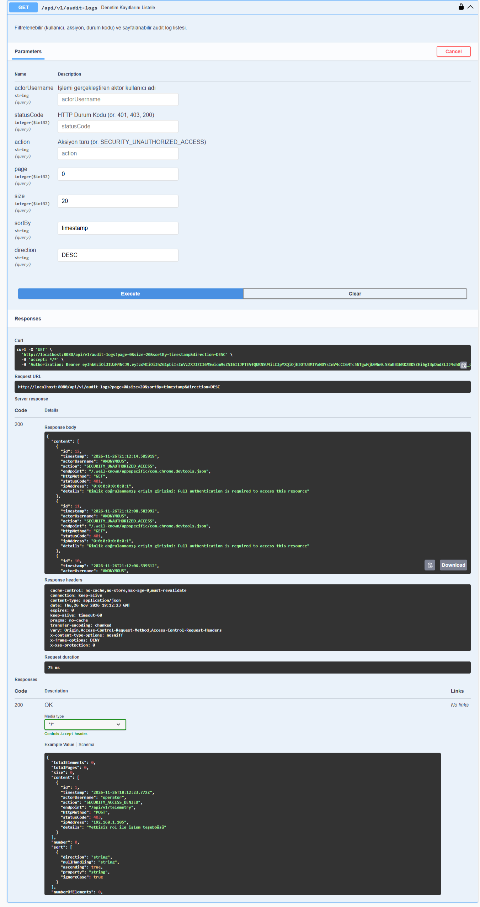

# SentinelGate - Kritik Altyapı İzleme ve Güvenli Mesajlaşma Backend Sistemi

[](docs/V_MODEL_TEST_PLAN.md)
[](https://adoptium.net/)
[](https://spring.io/projects/spring-boot)
[](docs/ARCHITECTURE.md)
[](#)

SentinelGate; askeri üsler, enerji nakil şebekeleri, nükleer santraller, radar sahaları ve kritik kamu altyapılarında görev yapan saha sensörlerinden gelen telemetri verilerini güvenli (şifreli, kriptografik SHA-256 bütünlük doğrulamalı) toplayan, komuta kontrol operatör ekranlarına anlık ve güvenilir biçimde ileten, tüm kritik adımları ve yetkisiz erişim denemelerini kayıt altına alan **Savunma Sanayi sınıfı bir Backend platformudur**.

Proje, **V-Model (V-Shaped SDLC)** prensiplerine göre gereksinimden kabul testine kadar tam izlenebilirlik (Traceability) ilkelerine bağlı kalınarak geliştirilmiştir.

---

## 🌟 Temel Özellikler

- **V-Model Metodolojisi:** DO-178C ve IEEE standartları referans alınarak her geliştirme fazına karşılık gelen bir doğrulama ve test planı.
- **Zero-Trust & Stateless JWT:** `io.jsonwebtoken (JJWT 0.12.x)` ile 256-bit HMAC-SHA algoritmalı güvenli token üretimi ve doğrulaması.
- **Rol Bazlı Erişim Denetimi (RBAC):**
  - `ROLE_ADMIN`: Sistem yönetimi, denetim (audit) logları inceleme, kullanıcı ve sensör aktör yetkilendirme.
  - `ROLE_OPERATOR`: Telemetri izleme, durum değerlendirme ve sahadan gelen alarmları sorgulama.
  - `ROLE_SENSOR`: Yalnızca telemetri verisi gönderme iznine sahip kısıtlı IoT / saha rolü.
- **Kriptografik Veri Mührü:** Saha sensörlerinden iletilen her telemetri paketi için `SHA-256` payload hash üretilerek veri bütünlüğü garanti edilir.
- **Otomatik Audit Log Sistemi:** Kritik operasyonların yanı sıra sisteme yönelik tüm yetkisiz erişim denemelerini (HTTP 401 Unauthorized / HTTP 403 Forbidden) istemci IP'si, uç nokta, metod ve detaylarla `audit_logs` tablosunda denetim altına alma.
- **OpenAPI 3 / Swagger Entegrasyonu:** Yetkilendirme başlığı (Bearer JWT Token) destekli interaktif API dokümantasyonu.
- **Multi-Stage Docker & Düşük Bellek Optimizasyonu:** Render / Koyeb ücretsiz katmanlarında (512MB RAM) sorunsuz çalışması için `-XX:+UseContainerSupport -Xmx350m` optimize edilmiş alpine konteyner mimarisi.

---

## 🏗️ Katmanlı Mimari ve Dizin Yapısı

Detaylı mimari dokümantasyon için [docs/ARCHITECTURE.md](docs/ARCHITECTURE.md) ve test planı için [docs/V_MODEL_TEST_PLAN.md](docs/V_MODEL_TEST_PLAN.md) dosyalarını inceleyebilirsiniz.

```
com.sentinelgate
├── SentinelGateApplication.java        # Spring Boot Bootstrap Runner
├── audit                               # Denetim ve Güvenlik İhlali Kayıt Servisi (AuditLogService)
├── config                              # Swagger / OpenAPI Konfigürasyonu (OpenApiConfig)
├── controller                          # REST API Uç Noktaları (AuthController, TelemetryController, AuditLogController)
├── dto                                 # İstek / Yanıt Sözleşmeleri ve Validasyonlar (DTO)
├── entity                              # JPA Veritabanı Varlıkları (User, TelemetryRecord, AuditLog)
├── exception                           # Global Hata Yakalama ve Standart Hata Yanıtları
├── repository                          # Spring Data JPA Veri Erişim Arayüzleri
├── security                            # Stateless JWT Filtresi, RBAC ve Yetkilendirme İşleyicileri
└── service                             # İş Mantığı Servisleri (AuthService, TelemetryService, DataInitializer)
```

---

## 📊 Sistem Mimarisi ve Akış Diyagramları (Mermaid)

### 1. Veritabanı Varlık-İlişki Şeması (ER Diagram)



---

### 2. Güvenlik ve Telemetri Uçtan Uca Akış Şeması (Sequence Diagram)



---

### 3. Sınıf Bağımlılık Mimarisi (Class Diagram)



---

## 📸 Canlı Demo & Swagger UI Ekran Görüntüleri

| **Swagger UI & API Uçları** | **JWT Kimlik Doğrulama (UC-01)** |
|:---:|:---:|
|  |  |
| **Telemetri & SHA-256 Bütünlüğü (UC-02/03)** | **Denetim İzleri & RBAC (UC-04)** |
|  |  |

---

## 🔒 Demo Kullanıcı Hesapları (Otomatik Seed Data)

Uygulama ilk ayağa kalktığında `DataInitializer` tarafından idempotent (yoksa oluşturan) demo kullanıcılar tanımlanır:

| Kullanıcı Adı | Şifre | Rol | Yetki Kapsamı |
|---|---|---|---|
| `admin` | `Admin123!` | `ROLE_ADMIN` | Tüm sistem yönetimi, yeni kullanıcı kaydı ve Audit Logları |
| `operator` | `Oper123!` | `ROLE_OPERATOR` | Telemetri sorgulama ve kritik alarmları izleme |
| `sensor-01` | `Sensor123!` | `ROLE_SENSOR` | Yalnızca telemetri verisi gönderme (`POST /api/v1/telemetry`) |

---

## 🚀 Hızlı Başlangıç ve Çalıştırma

### 1. Docker Compose ile Başlatma (PostgreSQL + API)
SentinelGate API ve PostgreSQL veritabanını izole bir ağda tek komutla ayağa kaldırmak için:

```bash
docker-compose up --build -d
```

Servisler ayağa kalktığında:
- **API URL:** `http://localhost:8080`
- **Swagger UI:** `http://localhost:8080/swagger-ui.html`
- **OpenAPI JSON:** `http://localhost:8080/v3/api-docs`
- **Healthcheck:** `http://localhost:8080/actuator/health`

Konteynerleri durdurmak için:
```bash
docker-compose down
```

### 2. Yerel Ortamda H2 Test Profili ile Çalıştırma
Harici bir veritabanı kurulumuna ihtiyaç duymadan, gömülü H2 in-memory veritabanı ile hızlıca başlatmak için:

```bash
# Windows ortamında:
./mvnw.cmd spring-boot:run -Dspring-boot.run.profiles=test

# Linux / macOS ortamında:
./mvnw spring-boot:run -Dspring-boot.run.profiles=test
```

### 3. Test Paketini Yürütme
Birim ve MockMvc güvenlik entegrasyon testlerini koşturmak için:

```bash
./mvnw.cmd test
```

---

## 📖 Swagger UI Kullanım Adımları

1. Tarayıcınızdan `http://localhost:8080/swagger-ui.html` adresine gidin.
2. `Kimlik Doğrulama & Yetkilendirme (Auth)` başlığı altındaki `POST /api/v1/auth/login` ucunu açın:
   - `admin` / `Admin123!` bilgilerini girerek **Execute** butonuna basın.
   - Dönen yanıttaki `token` değerini kopyalayın.
3. Sayfanın sağ üst köşesindeki **Authorize (Kilit İkonu)** butonuna tıklayın.
4. Açılan pencerede `Value` alanına `Bearer <KOPYALANAN_TOKEN>` veya doğrudan kopyaladığınız token'ı yapıştırıp **Authorize** ve ardından **Close** butonuna basın.
5. Artık korunan telemetri ve denetim logları uç noktalarını interaktif olarak test edebilirsiniz.

---

## 🧪 Postman ile Test
Hazır senaryolar içeren test koleksiyonu `postman/SentinelGate.postman_collection.json` dosyasında yer almaktadır. Postman'e aktararak otomatik token yakalama ve tüm RBAC senaryolarını test edebilirsiniz.

---

## 📄 Lisans
Bu proje Savunma Sanayi Kritik Altyapı Güvenliği spesifikasyonlarına uygun olarak geliştirilmiştir.
