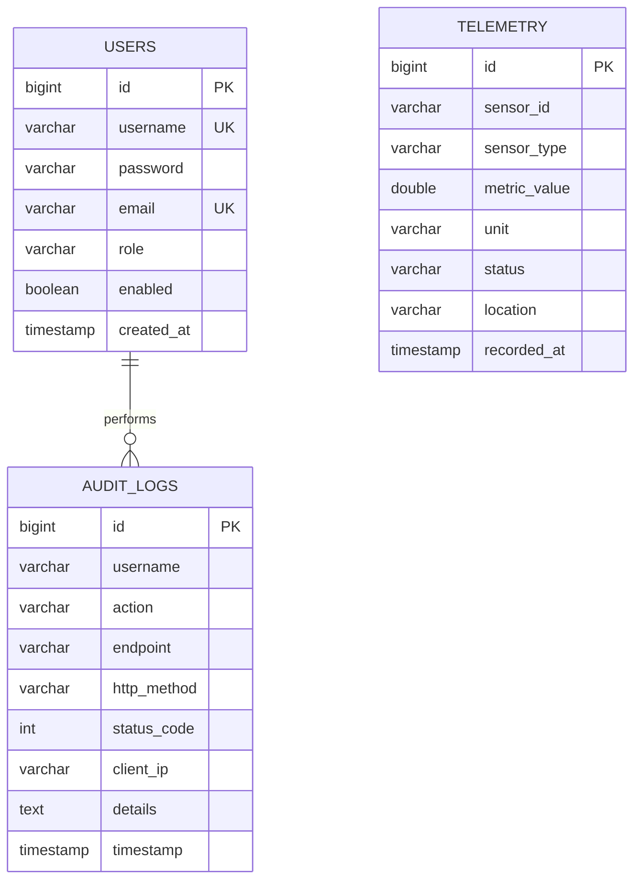

# SentinelGate - Sistem Mimarisi Tasarım Dokümanı (Architecture Document)

**Proje Kodu:** SG-C2-ARCH-01  
**Sürüm:** 1.0.0  
**Standartlar:** V-Model SDLC, Savunma Sanayi Yazılım Geliştirme Standartları (DO-178C / MIL-STD-498 Referanslı), ISO/IEC/IEEE 12207, Zero-Trust Architecture  
**Tarih:** 2026-11-26  

---

## 1. Giriş ve Proje Amacı
**SentinelGate**, askeri üsler, enerji nakil hatları, nükleer/termik santraller, radar sahaları ve su arıtma tesisleri gibi **kritik milli altyapıların** sahadaki sensörlerinden gelen telemetri verilerini (sıcaklık, basınç, radyasyon seviyesi, titreşim vb.) şifreli, doğrulanabilir ve kesintisiz şekilde toplayan, operatör komuta kontrol merkezine güvenli aktaran ve her türlü operasyonu yadsınamaz biçimde denetim altına alan (Audit Logging) Savunma Sanayi sınıfı bir backend platformudur.

---

## 2. Mimari Prensipler (Defense-Grade Architectural Principles)

1. **Zero-Trust & Least Privilege (Sıfır Güven ve En Düşük Yetki):**
   - Sisteme dahil olan hiçbir aktör (admin, operatör veya sensör donanımı) varsayılan olarak güvenilir kabul edilmez.
   - Her istek kriptografik olarak imzalanmış JJWT (JSON Web Token) ile doğrulanır.
   - Rol Bazlı Erişim Denetimi (RBAC: `ROLE_ADMIN`, `ROLE_OPERATOR`, `ROLE_SENSOR`) katı kurallarla uygulanır.

2. **Stateless Scalability (Durumsuz Ölçeklenebilirlik):**
   - Sunucu tarafında HTTP oturumu tutulmaz (SessionCreationPolicy.STATELESS). 
   - Yatayda kolayca kümelenebilir (Horizontal Pod Autoscaling).

3. **Tam Denetlenebilirlik ve İnkâr Edilemezlik (Auditability & Non-Repudiation):**
   - Kritik operasyonlar (yeni sensör kaydı, eşik değeri aşımı telemetri verileri, kullanıcı işlemleri) ve sisteme yapılan tüm yetkisiz erişim denemeleri (HTTP 401 Unauthorized, HTTP 403 Forbidden) istemci IP'si, metod, endpoint ve zaman damgasıyla `audit_logs` tablosunda saklanır.

4. **Yüksek Hata Toleransı ve Dayanıklılık (Fault Tolerance):**
   - Global Exception Handling mekanizması ile tüm hatalar standart `ApiErrorResponse` formatında sarılır; sistem detayları ve iç istisnalar istemciye sızdırılmaz.

---

## 3. Katmanlı Mimari Yapısı (Layered Architecture)

Proje, Savunma Sanayi standartlarına uygun olarak sorumlulukların tam ayrıldığı katmanlı paket mimarisine sahiptir:

```
com.sentinelgate
├── SentinelGateApplication.java   # Spring Boot bootstrap & context runner
├── audit/                          # Güvenlik ve operasyonel denetim log mekanizması (AOP & Events)
│   ├── AuditLogFilter.java
│   ├── AuditLogAspect.java
│   └── AuditLogService.java
├── config/                         # Uygulama genel konfigürasyonları (Swagger, WebMvc, Auditing)
│   ├── OpenApiConfig.java
│   └── WebConfig.java
├── controller/                     # REST API Uç Noktaları (Giriş katmanı)
│   ├── AuthController.java
│   └── TelemetryController.java
├── dto/                            # Data Transfer Objects & İstek/Cevap Sözleşmeleri
│   ├── request/
│   │   ├── LoginRequest.java
│   │   ├── RegisterRequest.java
│   │   └── TelemetryCreateRequest.java
│   └── response/
│       ├── AuthResponse.java
│       ├── TelemetryResponse.java
│       ├── AuditLogResponse.java
│       └── ApiErrorResponse.java
├── entity/                         # JPA Veritabanı Varlıkları
│   ├── User.java
│   ├── Role.java
│   ├── Telemetry.java
│   └── AuditLog.java
├── exception/                      # Global Hata Yakalama ve Özel Hata Tipleri
│   ├── GlobalExceptionHandler.java
│   ├── ResourceNotFoundException.java
│   └── UnauthorizedException.java
├── repository/                     # Spring Data JPA Veri Erişim Arayüzleri
│   ├── UserRepository.java
│   ├── TelemetryRepository.java
│   └── AuditLogRepository.java
├── security/                       # Çekirdek Güvenlik ve JWT Entegrasyonu
│   ├── JwtTokenProvider.java
│   ├── JwtAuthenticationFilter.java
│   ├── SecurityConfig.java
│   ├── CustomUserDetailsService.java
│   └── UserPrincipal.java
└── service/                        # İş Mantığı Katmanı (Business Logic)
    ├── AuthService.java
    ├── TelemetryService.java
    └── SeedDataService.java
```

---

## 4. Güvenlik ve RBAC Matrisi

| Rol | Yetki Kapsamı | İzin Verilen Uç Noktalar |
|---|---|---|
| **ANONYMOUS** | Kimlik Doğrulama | `/api/v1/auth/login`, `/api/v1/auth/register`, `/v3/api-docs/**`, `/swagger-ui/**`, `/actuator/health` |
| **ROLE_SENSOR** | Telemetri İletimi | `POST /api/v1/telemetry` |
| **ROLE_OPERATOR** | Durumsal İzleme ve Telemetri Okuma | `GET /api/v1/telemetry/**` |
| **ROLE_ADMIN** | Tam Sistem Yönetimi, Denetim Logları, Sensör & Operatör Yetkilendirme | Tüm endpoint'ler, `GET /api/v1/audit-logs/**`, Kullanıcı Yönetimi |

---

## 5. Veritabanı Şeması (Core ER Diyagramı)



---

## 6. Dağıtım ve Bulut Mimarisi
- Docker Multi-Stage Build: Build aşamasında Maven + OpenJDK, Runtime aşamasında hafif Alpine JRE.
- En Az Ayricalıklı Kullanıcı: `sentinel` servis kullanıcısı altında çalışma.
- Bellek Limiti: Render ve Koyeb ücretsiz katmanları göz önüne alınarak `-Xmx350m -Xms128m -XX:+UseG1GC` yapılandırması.
