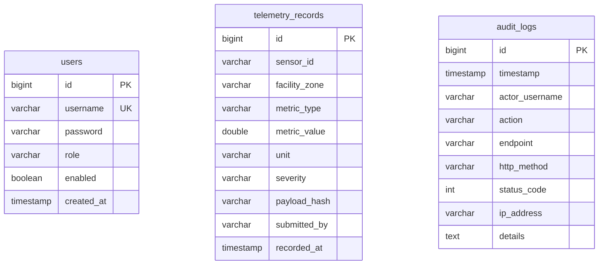
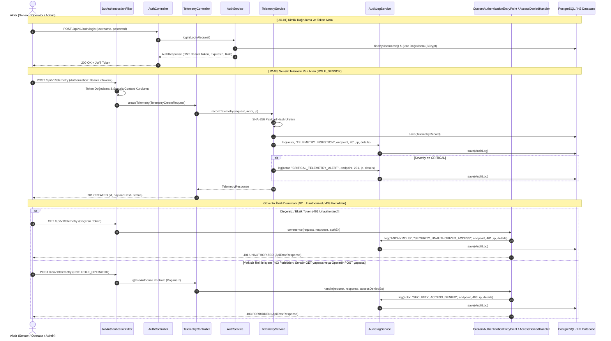

# SentinelGate - Sistem Mimarisi Tasarım Dokümanı (Architecture Document)

**Proje Kodu:** SG-C2-ARCH-01  
**Sürüm:** 1.0.0  
**Standartlar:** V-Model SDLC, Savunma Sanayi Yazılım Geliştirme Standartları (DO-178C / MIL-STD-498 Referanslı), ISO/IEC/IEEE 12207, Zero-Trust Architecture  
**Tarih:** 2026-11-26  

---

## 1. Giriş ve Proje Amacı
**SentinelGate**, askeri üsler, enerji nakil hatları, nükleer/termik santraller, radar sahaları ve su arıtma tesisleri gibi **kritik milli altyapıların** sahadaki sensörlerinden gelen telemetri verilerini (sıcaklık, basınç, radyasyon seviyesi, titreşim vb.) şifreli, doğrulanabilir ve kesintisiz şekilde toplayan, operatör komuta kontrol merkezine güvenli aktaran ve her türlü operasyonu yadsınamaz biçimde denetim altına alan (Audit Logging) Savunma Sanayi sınıfı bir backend platformudur.

---

## 2. Mimari Prensipler (Defense-Grade Architectural Principles)

1. **Zero-Trust & Least Privilege (Sıfır Güven ve En Düşük Yetki):**
   - Sisteme dahil olan hiçbir aktör (admin, operatör veya sensör donanımı) varsayılan olarak güvenilir kabul edilmez.
   - Her istek kriptografik olarak imzalanmış JJWT (JSON Web Token) ile doğrulanır.
   - Rol Bazlı Erişim Denetimi (RBAC: `ROLE_ADMIN`, `ROLE_OPERATOR`, `ROLE_SENSOR`) katı kurallarla uygulanır.

2. **Stateless Scalability (Durumsuz Ölçeklenebilirlik):**
   - Sunucu tarafında HTTP oturumu tutulmaz (`SessionCreationPolicy.STATELESS`). 
   - Yatayda kolayca kümelenebilir (Horizontal Pod Autoscaling).

3. **Tam Denetlenebilirlik ve İnkâr Edilemezlik (Auditability & Non-Repudiation):**
   - Kritik operasyonlar (`DataInitializer`, sensör telemetri alımı, kritik alarm durumları) ve sisteme yapılan tüm yetkisiz erişim denemeleri (HTTP 401 Unauthorized, HTTP 403 Forbidden) istemci IP'si, metod, endpoint ve zaman damgasıyla `audit_logs` tablosunda saklanır.

4. **Kriptografik Veri Bütünlüğü (Data Integrity):**
   - Saha sensörlerinden gelen her telemetri paketi için `SHA-256` hash özeti üretilerek `payload_hash` alanında saklanır. Verinin sonradan değiştirilmediği kriptografik olarak doğrulanabilir.

5. **Yüksek Hata Toleransı ve Dayanıklılık (Fault Tolerance):**
   - Global Exception Handling mekanizması ile tüm hatalar standart `ApiErrorResponse` formatında sarılır; sistem detayları ve iç istisnalar istemciye sızdırılmaz.

---

## 3. Katmanlı Mimari Yapısı (Layered Architecture)

Proje, Savunma Sanayi standartlarına uygun olarak sorumlulukların tam ayrıldığı katmanlı paket mimarisine sahiptir:

```
com.sentinelgate
├── SentinelGateApplication.java        # Spring Boot ana giriş noktası
├── audit/                              # Güvenlik ve operasyonel denetim log servisi
│   └── AuditLogService.java
├── config/                             # Swagger/OpenAPI ve Web konfigürasyonları
│   └── OpenApiConfig.java
├── controller/                         # REST API Uç Noktaları
│   ├── AuthController.java
│   ├── TelemetryController.java
│   └── AuditLogController.java
├── dto/                                # Data Transfer Objects (DTO) & İstek/Cevap Sözleşmeleri
│   ├── request/
│   │   ├── LoginRequest.java
│   │   ├── RegisterRequest.java
│   │   └── TelemetryCreateRequest.java
│   └── response/
│       ├── AuthResponse.java
│       ├── TelemetryResponse.java
│       ├── AuditLogResponse.java
│       └── ApiErrorResponse.java
├── entity/                             # JPA Veritabanı Varlıkları
│   ├── User.java
│   ├── Role.java
│   ├── TelemetryRecord.java
│   ├── Severity.java
│   └── AuditLog.java
├── exception/                          # Global Hata Yakalama ve Özel Hata Tipleri
│   ├── GlobalExceptionHandler.java
│   ├── BadRequestException.java
│   └── ResourceNotFoundException.java
├── repository/                         # Spring Data JPA Veri Erişim Katmanı
│   ├── UserRepository.java
│   ├── TelemetryRepository.java
│   └── AuditLogRepository.java
├── security/                           # Çekirdek Güvenlik, JWT ve Filtre Zinciri
│   ├── JwtService.java
│   ├── JwtAuthenticationFilter.java
│   ├── SecurityConfig.java
│   ├── CustomUserDetailsService.java
│   ├── UserPrincipal.java
│   ├── CustomAccessDeniedHandler.java
│   └── CustomAuthenticationEntryPoint.java
└── service/                            # İş Mantığı ve Başlangıç Veri Servisleri
    ├── AuthService.java
    ├── TelemetryService.java
    └── DataInitializer.java
```

---

## 4. Güvenlik ve RBAC Matrisi

| Rol | Yetki Kapsamı | İzin Verilen Uç Noktalar |
|---|---|---|
| **ANONYMOUS** | Kimlik Doğrulama & Genel Bilgi | `POST /api/v1/auth/login`, `/v3/api-docs/**`, `/swagger-ui/**`, `/actuator/health` |
| **ROLE_SENSOR** | Telemetri İletimi | `POST /api/v1/telemetry` |
| **ROLE_OPERATOR** | Durumsal İzleme ve Telemetri Okuma | `GET /api/v1/telemetry/**` (`/`, `/critical`, `/recent`, `/{id}`) |
| **ROLE_ADMIN** | Tam Sistem Yönetimi, Denetim Kayıtları, Yeni Kullanıcı/Sensör Kaydı | Tüm uç noktalar, `POST /api/v1/auth/register`, `GET /api/v1/audit-logs/**` |

---

## 5. Mimari Görselleştirmeler (Mermaid UML)

### 5.1. Varlık İlişki Diyagramı (Entity Relationship - ER Diagram)



---

### 5.2. Sıralama Diyagramı (Sequence Diagram: Login, Telemetry & Audit Flows)



---

### 5.3. Sınıf Bağımlılık Diyagramı (Class Diagram)

```mermaid
classDiagram
    direction TB

    class AuthController {
        -AuthService authService
        +login(LoginRequest) ResponseEntity~AuthResponse~
        +register(RegisterRequest) ResponseEntity~AuthResponse~
    }

    class TelemetryController {
        -TelemetryService telemetryService
        +createTelemetry(TelemetryCreateRequest, Authentication, HttpServletRequest) ResponseEntity~TelemetryResponse~
        +getAllTelemetry(int, int, String, String) ResponseEntity~Page~
        +getCriticalTelemetry() ResponseEntity~List~
        +getRecentTelemetry() ResponseEntity~List~
        +getTelemetryById(Long) ResponseEntity~TelemetryResponse~
    }

    class AuditLogController {
        -AuditLogService auditLogService
        +getAuditLogs(String, Integer, String, int, int, String, String) ResponseEntity~Page~
    }

    class AuthService {
        -UserRepository userRepository
        -PasswordEncoder passwordEncoder
        -AuthenticationManager authenticationManager
        -JwtService jwtService
        +login(LoginRequest) AuthResponse
        +register(RegisterRequest) AuthResponse
    }

    class TelemetryService {
        -TelemetryRepository telemetryRepository
        -AuditLogService auditLogService
        +recordTelemetry(TelemetryCreateRequest, String, String) TelemetryResponse
        +getAllTelemetry(Pageable) Page~TelemetryResponse~
        +getCriticalTelemetry() List~TelemetryResponse~
        +getRecentTelemetry() List~TelemetryResponse~
        +getTelemetryById(Long) TelemetryResponse
    }

    class AuditLogService {
        -AuditLogRepository auditLogRepository
        +log(String, String, String, String, int, String, String) void
        +getAuditLogs(String, Integer, String, Pageable) Page~AuditLogResponse~
    }

    class JwtService {
        -String secretKey
        -long expirationMs
        +generateToken(Authentication) String
        +validateToken(String) boolean
        +extractUsername(String) String
        +extractRole(String) String
    }

    class JwtAuthenticationFilter {
        -JwtService jwtService
        -CustomUserDetailsService userDetailsService
        #doFilterInternal(HttpServletRequest, HttpServletResponse, FilterChain) void
    }

    class CustomAccessDeniedHandler {
        -AuditLogService auditLogService
        +handle(HttpServletRequest, HttpServletResponse, AccessDeniedException) void
    }

    class CustomAuthenticationEntryPoint {
        -AuditLogService auditLogService
        +commence(HttpServletRequest, HttpServletResponse, AuthenticationException) void
    }

    class DataInitializer {
        -UserRepository userRepository
        -TelemetryRepository telemetryRepository
        -AuditLogService auditLogService
        -PasswordEncoder passwordEncoder
        +run(String[]) void
    }

    AuthController --> AuthService
    TelemetryController --> TelemetryService
    AuditLogController --> AuditLogService
    TelemetryService --> AuditLogService
    CustomAccessDeniedHandler --> AuditLogService
    CustomAuthenticationEntryPoint --> AuditLogService
    DataInitializer --> AuditLogService
    JwtAuthenticationFilter --> JwtService
    AuthService --> JwtService
```



---

## 6. Dağıtım ve Bulut Mimarisi
- **Docker Multi-Stage Build:** Build aşamasında Maven + OpenJDK, Runtime aşamasında hafif Alpine JRE.
- **En Az Ayrıcalıklı Kullanıcı:** `sentinel` servis kullanıcısı altında konteyner izolasyonu.
- **Bellek ve Konteyner Optimizasyonu:** Render ve Koyeb ücretsiz katmanları (512MB RAM) için `-XX:+UseContainerSupport -Xmx350m -Xms128m -XX:+UseG1GC` yapılandırması.
